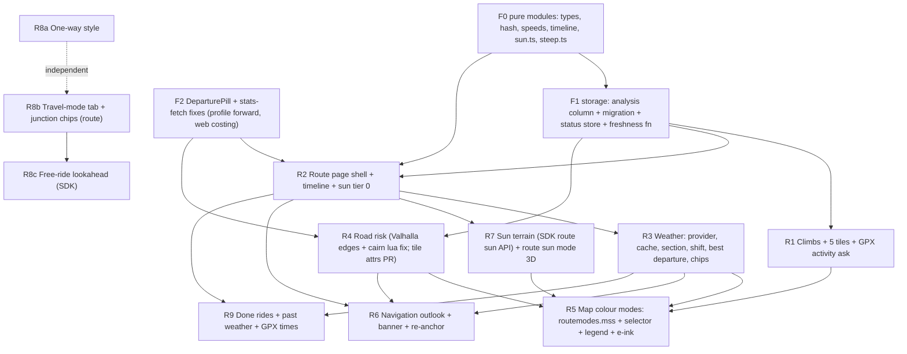

# 00 - Unified design: route analysis, route page, map language

Design only. No app code was touched. Mockups: [`00-unified-design.html`](00-unified-design.html) (fake data, light / dark / e-ink toggle).
Source of truth for product decisions: [`DECISIONS.md`](DECISIONS.md). Per-feature research: `01`..`05` in this folder.
Paths are relative to `/Volumes/dev/nativescript/alpimaps` (`app/...`) unless stated. `file:line` refs were read on 2026-11-01 on the
current working tree. "Unverified" marks anything I did not run or read at the source. Web facts are untrusted data, cited with URLs.

Where this document disagrees with a per-feature report, **this one wins** (list in section 9).

---

## 0. The design in 12 lines

1. **Three surfaces, one data model.** Route *sheet* = glance (5 tiles, profile, insights chips). Route *page* = plan and analyse
   (departure, pace, every section). *Map* = colour mode + symbols. All three read one `RouteAnalysis` stored on the item.
2. **Five tiles**: Distance, Time, **Elevation (D+ / D- merged)**, **Steep**, **Risk** (bike, computed routes only). Weather and sun are
   *not* tiles: they are chips in an "Insights" card on the sheet and sections on the page. Tiles that do not fit at the current width
   / font scale spill into those chips.
3. **One timeline** (`RouteTimeline`: vertex index -> seconds since departure). Weather, sun, ETA, navigation re-timing all look up
   into it. Nothing else computes an ETA.
4. **Layers with provenance.** `terrain`, `risk`, `weather`, `sun` are separate layers, each with `computedAt`, `inputsHash`,
   provider, data version. Classification (steep, climbs, risk level, sun state, wind components, best departure) is **derived on
   read**, never stored.
5. **Freshness is a first-class state** (`fresh | aging | stale | inputs-changed | offline-cached | failed | pinned`), shown as an
   outlined chip with "as of 14:05 - 3 h", refreshed by one affordance, never blocking.
6. **Local re-timing**: the departure shift slider, the "now" departure and the navigation re-anchor re-read stored hourly series;
   no refetch. Only the terrain sun test needs a (fast, offline, native) recompute when the timeline changes.
7. **Map = one colour mode at a time** (Plain, Surface, Grade, Steep, Risk, Sun, Weather) on the route line, plus a per-mode
   **symbol** set (speed badges, weather markers, steep chevrons). One coordinated style file `routemodes.mss` for voyager and eink,
   one feature contract (`class='rt'`, `rt`, `k`, `s`).
8. **E-ink grammar** is shared by map and profile: black slice, white tick density = severity (none / sparse / dense / solid).
9. **Profile = one chart, ribbons on demand**: chips with counts double as ribbon toggles (max 3 at once, collapsed by default),
   shared x axis, one scrubber linked to map marker, ETA, weather and sun at that point.
10. **Navigation** shows the *remaining* route: banner for road risk only, a "Next 2 h" outlook strip, steep never as a warning.
11. **Travel mode** is a docked tab on the GPS follow button (tap cycles, long-press opens options). It also feeds presets.
12. **Roadmap**: R1 climbs + 5 tiles (S-M), R2 timeline + route page + sun tier 0 (L), R3 weather (L), R4 road risk (M, gated on a
    cairn lua fix), R5 map colour modes (L), R6 navigation outlook (M), R7 terrain sun / route sun mode (M + SDK), R8 wrong-way + travel
    mode (S then M then L), R9 done rides + past weather (M).

---

## 1. Information architecture

### 1.1 What lives where

| Surface | Job | Existing host | New |
| --- | --- | --- | --- |
| Route **sheet** (bottom sheet) | Glance and act: tiles, profile, quick facts, navigate | `components/bottomsheet/BottomSheetInner.svelte` | 5-tile header, ribbon chips on the chart, **Insights card**, `analysis` action |
| Route **page** (new, full page) | Plan (departure, pace, activity) and read everything, collapsible sections, save data | none (pattern: `navigate({ page })` as `showItemsList` does, `components/map/MapScrollingWidgets.svelte:~120`) | `components/routeanalysis/RoutePage.svelte` + one component per section |
| **Map** | Spatial reading of one dimension at a time | `ItemsModule.onItemSelected` (`mapModules/ItemsModule.ts:549`), `NavigationRouteModule.draw` (`:289`) | colour mode selector, legend rows, `routemodes.mss` |
| **Navigation** | Remaining route, timely | `components/navigation/NavigationView.svelte` | banner slot, outlook widget |
| **Settings** | Thresholds, defaults | `components/settings/Settings.svelte` (Routing section, `:~700-725`) | "Route analysis" sub-page |

The sheet never gains new tall cards for each feature (that was the failure mode of the five separate proposals: 5 tiles + 4 cards +
2 chart rows). It gains **one** card and a link to the page. The page is where depth lives.

### 1.2 The tile row: five tiles, and what fits

Today: `RouteStatTiles.svelte` builds 4 tiles in `tilesFor` (`:42`), laid out as equal `*` columns (`:63`), 40 dp high inside the
48 dp row (`ROUTE_TILES_HEIGHT`, `BottomSheetInner.svelte:89`; the header is `ROUTE_TITLE_HEIGHT 70 + 48 = 118 dp`,
`:91`, `:137-139`. `docs/design/README.md` says "86 + 48": the 86 is the marker header, 70 is the route title band: no contradiction,
but update the README wording).

| # | Tile | Value | Shown when | Weight | Second line (accent, flag) |
| --- | --- | --- | --- | --- | --- |
| 1 | Distance | `12.4 km` | always | 0.95 | remaining distance (exists) |
| 2 | Time | `2 h 23` | `totalTime > 0` or a timeline exists | 0.9 | remaining time (exists); otherwise **arrival clock time** when a departure is set |
| 3 | **Elevation** | `↗ 820 ↘ 790` (D+ / D- merged, as the user asked) | profile or `properties.ascent` | **1.9** | remaining ascent only |
| 4 | **Steep** | `3.4 km` (length >= "steep" threshold) | profile with `g`, total > 0 | 0.8 | none |
| 5 | **Risk** | `⚠ 12.4 km` (exposed length, danger-outlined) | bicycle + computed route + risk layer present, exposed > 0 | 0.9 | none |

Decisions:

- **Weather and sun are not tiles.** The user said sun is a separate section "unless a nice solution exists"; I looked: a 6th tile
  breaks 320 dp, and a *rotating* 5th tile (risk -> weather -> sun) makes the row unpredictable. Fixed roles win. Weather and sun
  show as **chips in the Insights card** (below) with the same icon + value idiom, so nothing is lost.
- **Width budget** (checked in the HTML mockup at 320 dp: it does not fit with icons on all five). At 320 dp the row has about 294 dp
  (`padding 0 7`, `margin 0 3`, `RouteStatTiles.svelte:63,72`; sheet card margin 6). Weights 0.95 / 0.9 / 1.9 / 0.8 / 0.9 (the Elevation tile needs the most room: two figures). Rules below 360 dp:
  **Distance and Time lose their icon** (their unit / clock format says what they are; the tooltip names them), **Steep and Risk lose
  their unit** (`3.4`, `9.8`; the glyph is their only label), the Elevation tile keeps its two arrows (they are its icons) and drops
  `m`. Tile font 12.5-13. If the row still does not fit at the current `fontScaleMaxed` the tile is **dropped from the row and becomes an Insights
  chip** (drop order: Risk, then Steep). The row never wraps and never scrolls. At >= 360 dp every tile has its icon back.
- **Tap on a tile** (plain tap, no tutorial entry) opens the route page scrolled to the matching section (Distance/Time -> Plan,
  Elevation -> Elevation, Steep -> Climbs, Risk -> Road safety). Long press keeps the tooltip (`showToolTip`, `:70`).
- Risk uses the danger outline (design README: warnings are an outlined label, not a filled block). Steep is tinted only when the very
  steep length is > 0. E-ink: 1 px border on every tile already (`borderWidth={isEInk ? 1 : 0}`), risk gets 2 px.
- Hiking routes: 4 tiles (no Risk), the Elevation tile takes the freed width.

### 1.3 The sheet after the change

Rows today (`BottomSheetInner.svelte:1124`): `header, actions, profile(215), stats(164), osm`. After:

`header (118) | actions | profile (215, +ribbon chips row 28 when any layer exists) | insights (56, only if >= 1 layer) | stats (164) | osm`

**Insights card** (`RouteInsights.svelte`, `class="panel"`, like the other cards): one horizontally scrollable row of chips, each = icon +
value + freshness dot, tap -> page at that section:

`☂ 3.1 mm · km 62` `☀ 62 % sun` `☾ dark 53 min` `⛰ 5 climbs · 1 Cat 3` `⚠ 3 fast sections` `Plan departure ›`

Rules: a chip exists only for a layer that exists; stale layers show the chip dimmed with the clock glyph; the trailing
`Plan departure ›` / `Analyse ›` chip is always there and is the primary entry point. Height adds one step in `updateSteps`
(`BottomSheetInner.svelte:536`), same mechanism as `osmHeight`.

Actions row: add an `analysis` round action (`mdi-chart-timeline-variant`, tooltip "Plan and analyse") in the `itemActions` list
(`:327`+; handlers map `:306-322`). The existing `profile` and `stats` actions stay as they are (minimal diff); the page calls the
same `packageService` functions.

### 1.4 The Route page

Full page (phone). On a >= 600 dp wide window it can open as a side panel instead (cut from v1, see section 7).

```
┌ PanelHeader: [route-type tile] name · "Cycling · road · saved"   [refresh all] [⋮] ┐
│ hero: item.image_path snapshot (exists: ItemsModule.takeItemPicture)  + "Show on map" │
├ PLAN card (always expanded, not collapsible) ─────────────────────────────────────┤
│ Activity pill (Hike | Bike · road …)   Departure pill [Sat 2 Nov 08:00]            │
│ Pace  ──●──  x1.0 (flat 18 km/h)    Stops  ──●── 5 min/h        [Compute all]      │
│ → arrives 16:48 · duration 3 h 02 · sunset 17:12                    updated 14:05   │
│ banner (conditional): "Departure passed. Shift to now?"  [Shift] [Keep]            │
├ PINNED PROFILE (80 dp, scrubber, ribbon chips) ───────────────────────────────────┤  one chart for the whole page
├ Sections (each: icon tile, title, one-line summary, freshness chip, chevron) ─────┤
│ ▸ Elevation          ↗ 820 ↘ 790 · 214–1 420 m                                     │
│ ▸ Climbs & steep     5 climbs · 3.4 km steep · max 16 %      (collapsible rows)    │
│ ▸ Road safety (bike) 3 fast sections · 12.4 km · tagged                            │
│ ▸ Weather            8–17 °C · 3.1 mm at km 62 · best: 45 min earlier              │
│ ▸ Sun & shade        62 % sun · dark 53 min · glare 4 km                           │
│ ▸ Road & surface     way types / surfaces (existing RouteStatsView)                │
│ ▸ Saved with this route   weather snapshot 38 KB · sun 2 KB · [Pin] [Remove]       │
├ Footer: attributions (Open-Meteo CC BY 4.0, OSM, DEM)                              ┤
└────────────────────────────────────────────────────────────────────────────────────┘
```

Behaviour:

- **One chart, pinned** under the Plan card: sections do not draw their own charts. Tapping a row in any section (a climb, a risky
  section, a weather sample) moves the scrubber / zooms the chart range (`range` prop, `ElevationChart.svelte:107`) and highlights
  the map cursor. This is what keeps the page from becoming five stacked charts.
- **Collapsible**: every section header toggles; state persists per section (`route_page_sections`, `ApplicationSettings`).
  Defaults: Plan and Elevation open, others collapsed except the first section that has an alert (risk or steep very-steep, rain).
  Collapsed header shows the one-line summary, so the page is useful closed. "Step sections must be collapsible" (decision 02.6)
  also holds *inside* Climbs & steep: the steep list collapses to its summary line.
- **Per-section states**: `absent` (compute CTA card: "Not computed. Compute (uses Valhalla offline)" or "Fetch weather
  (sends ~20 positions rounded to 2 decimals to Open-Meteo)"), `running` (indeterminate bar in header), `done`, `failed`, `offline`.
  The privacy sentence sits on the weather CTA, as in 03.
- **Plan card inputs** (all persisted in `analysis.inputs`, section 2): activity, departure (`now` or a time; long press = back to
  `now`, same gesture as the transit pill, `DirectionsPanel.svelte:896-905`), pace multiplier 0.8-1.3 (decision 03.3), stops
  minutes per hour, optional extra days (multi-day, decision 03.4: day k start time + max hours; model in section 2.2).
- **Compute all**: runs the ordered stages of section 2.4 with a global progress line ("3 of 5: weather") and cancel.
- **Save data / attach** (decision "save a route you did with its data attached"): the *last snapshot of each layer is always
  persisted on the item* (needed to reopen offline hours later). "Pin" marks a layer `pinned` = never auto-refreshed or replaced
  (what a *done ride* wants). "Remove data" clears layers and frees the bytes.
- **Done mode** (ride in the past): see 1.6.

### 1.5 Entry points

| From | Gesture | Lands on |
| --- | --- | --- |
| Route sheet, Insights card (any chip, or `Plan departure ›`) | tap | page at that section |
| Route sheet, `analysis` action | tap | page top |
| Route sheet, tile | tap | page at the matching section |
| Routes list row (`components/items/ItemsList.svelte`) | row menu `Analyse`; row shows a departure chip (`Sat 08:00`) when set and a dim data glyph when layers are stale | page |
| Directions result (unsaved item, `DirectionsPanel`) | `Analyse` button in the result header | page on a *transient* analysis (in memory), persisted when the route is saved (`mapContext.saveItem`) |
| End of a recording (`GeoHandler` session end) | "Ride saved" sheet: `Save with weather & sun` | page in **Done mode** |
| GPX import (`ItemsModule.importGPXFile`, `:709`) | nothing at import | first analysis that needs a preset asks (1.7) |
| Navigation start (`navigationService.start`, `NavigationService.ts:201`) | if departure passed / data stale: one non-blocking line in the start sheet | none (navigation proceeds) |

### 1.6 Done rides and past weather (feasibility)

User ask: "a route you did, saved with its data attached (weather, ...), done afterwards, past weather can be fetched."

Open-Meteo has two relevant, documented APIs (fetched 2026-11-01; data from their docs pages, treated as untrusted):

| API | Endpoint | Coverage | Resolution | Notes |
| --- | --- | --- | --- | --- |
| Historical Forecast | `https://historical-forecast-api.open-meteo.com/v1/forecast` (same params as forecast: `start_date`, `end_date`, `hourly`, `models`, `elevation`) | archived model runs "around 2021-2022" onward | model dependent, 1-5 km regional (AROME France HD 0.01 deg), hourly; 15 min only in central Europe / N. America | stitched from the first hours of each run; "not suitable for long time series"; no publication delay stated on the page. <https://open-meteo.com/en/docs/historical-forecast-api> |
| Historical Weather (ERA5) | `https://archive-api.open-meteo.com/v1/archive` | ERA5 from 1940 (0.25 deg, ~25 km), ERA5-Land from 1950 (0.1 deg, ~11 km), IFS 9 km from 2017 | hourly | latest ERA5 data has a **5-day delay**; has `temperature_2m`, `precipitation`, wind + gusts, `cloud_cover`, `direct_normal_irradiance`, `sunshine_duration`; `elevation` downscaling param; multi-location. <https://open-meteo.com/en/docs/historical-weather-api> |
| Previous Runs | `https://previous-runs-api.open-meteo.com/v1/forecast` | most models since Jan 2024 | - | "what was forecast N days before"; **cut**: not needed for a done ride. <https://open-meteo.com/en/docs/previous-runs-api> |

Policy (implemented as `WeatherProvider.past(samples, window)`):

1. Ride date from 2022 on (including the last 5 days, which ERA5 does not have yet): **Historical Forecast** (finer, near-actual). Earlier rides: **ERA5** (coarse, flagged).
2. Provenance `source: 'historical-forecast' | 'archive-era5'` and the UI label is honest: **"Reconstructed from model data, not
   measured"**, plus the grid size for ERA5 ("~25 km").
3. Same sample / rounding / privacy rules as the forecast (explicit tap, 2 decimals), same attribution and terms (decision 03.1).
4. The snapshot is stored `pinned: true`; it never ages.
5. Sun for a past date is pure astronomy (suncalc, any date) + terrain test (same native call), cloud factor from the archive DNI.
6. Real timings: a recorded ride has timestamps. `GeoHandler.Session` carries `startTime`, `endTime`, `locs[]`
   (`handlers/GeoHandler.ts:66-80`) and `recordTrack` stores them (`:145`). For imported GPX, `importGPXToGeojson` spreads
   `...feature.properties` from `@tmcw/togeojson` (`utils/gpx.ts:21-24`), which (unverified, check on a real file) carries
   `coordinateProperties.times` when the GPX has `<time>`; R9 reads them into `analysis.recorded.t` so `timeline.model = 'recorded'`.

### 1.7 Imported GPX: ask once, remember, switchable (decision 02.2)

GPX / drawn tracks have no *meaningful* route type: `importGPXToGeojson` (`utils/gpx.ts:15-33`) silently sets
`properties.route.type = feature.properties.type || 'pedestrian'` (the raw GPX `<type>` string, unvalidated, else pedestrian) and
`route: { totalDistance }` only: no `waypoints`, no `instructions`, no `totalTime`. So "unknown" cannot be told from a deliberate
pedestrian choice by looking at `route.type`. Rule: a route is **unclassified** when it has no `analysis.inputs.activity` *and* is
imported (R1 adds one line in `importGPXFile`, `ItemsModule.ts:709`: `properties.imported = true`; before that, "no `route.waypoints`"
is the proxy, since computed routes always carry them, `ItemsModule.ts:552-567`).

- **Nothing is asked at import** (do not block the import flow).
- The first time an analysis needs an activity preset (steep thresholds, pace, weather weights) and none is known, a small modal sheet
  asks **"What is this track?"** with pills `Hiking`, `Cycling · road`, `Cycling · gravel`, `Cycling · MTB`, preselected from the last
  answer. The choice is stored as `analysis.inputs.activity = { kind, subtype, origin: 'user' }` and never asked again for that route.
- The Plan card's **Activity pill** shows it and switches it any time; switching invalidates only the layers whose `inputsHash`
  includes the activity (steep is derived, so it re-renders instantly; weather re-weights; risk stays off for tracks, decision 01.2).
- For computed routes `origin: 'route'`, derived from `properties.route.type/subtype` (`DirectionsPanel.svelte:134,864`).
  The pill is still editable (it records `origin: 'user'` and does not change `properties.route`, so navigation reroutes keep their
  Valhalla profile, `NavigationService.ts:173`).

---

## 2. `RouteAnalysis`: one model, one pipeline

### 2.1 Layers and what is stored

Pure TypeScript, no NativeScript imports (repo rule: can be exercised outside the app), under `app/utils/routeAnalysis/`.

```ts
export type LayerId = 'terrain' | 'risk' | 'weather' | 'sun';

export interface Activity {
    kind: 'hike' | 'bike' | 'motor';
    subtype?: 'walk' | 'run' | 'road' | 'gravel' | 'normal' | 'mountain' | 'enduro';
    origin: 'route' | 'user';
}

export interface Departure {
    mode: 'now' | 'planned' | 'recorded';
    /** epoch ms; absent in 'now' mode (floats with the clock) */
    at?: number;
    /** multi-day: day k starts at days[k].startAt and moves at most maxHours; day 0 == at */
    days?: { startAt: number; maxHours?: number }[];
    /** IANA zone of the route start (decision 05.9). From the first weather response; else the phone zone, flagged */
    tz?: string;
    tzFromPhone?: boolean;
}
export interface Pace {
    multiplier: number; // 0.8 .. 1.3
    stopsMinPerHour: number;
    model: 'proportional' | 'gradeAware' | 'recorded';
}

export interface AnalysisInputs {
    activity: Activity;
    departure: Departure;
    pace: Pace;
    /** cheap hash: vertex count + length + ~64 sampled vertices. Any geometry edit changes it */
    geometryKey: string;
}

export interface Provenance {
    computedAt: number;
    /** hash of exactly the inputs this layer depends on (table in 3.1) */
    inputsHash: string;
    provider: string;          // 'valhalla-offline@3.8.3' | 'open-meteo/forecast' | 'massif-sdk/routeSun'
    source?: 'forecast' | 'historical-forecast' | 'archive-era5' | 'recorded';
    /** weather: model name(s) and run init time when the provider reports it (unverified that the forecast API echoes it) */
    modelRun?: string;
    /** terrain / risk / sun: DEM source id, routing package date, tiles build */
    dataVersion?: string;
    /** time window the data is valid for (weather: first and last hour, epoch s) */
    coverage?: { from: number; to: number };
    quality: 'ok' | 'partial' | 'estimated';
}
export interface Layer<T> { prov: Provenance; data: T; pinned?: boolean }

export interface RouteAnalysis {
    v: 1;
    inputs: AnalysisInputs;
    layers: {
        terrain?: Layer<{ gradeOptions: string; demSource: string }>;        // meta only: profile stays in Item.profile
        risk?: Layer<{ v: 1; src: 'valhalla' | 'tiles'; candidates: RiskRun[]; unknown: number }>;  // 01 round 2's payload, moved here (section 9)
        weather?: Layer<WeatherData>;
        sun?: Layer<SunData>;
    };
    /** done rides: per-vertex seconds from the recording; replaces the modelled timeline */
    recorded?: { t: number[]; startedAt: number };
}

export interface WeatherData {
    /** profile vertex index and distance of each sample; coordinates are re-derived from the geometry (not stored) */
    samples: { i: number; d: number; alt: number }[];
    /** hour-aligned, UTC seconds; n hours per sample */
    t0: number; n: number;
    /** quantised ints [sample][hour]: temp x10, precip x10 (mm), wind x10 (km/h), gust x10, dir deg, cloud %, code, freezing level (m), dni (W/m2) */
    v: Record<'temp' | 'precip' | 'precipProb' | 'wind' | 'gust' | 'dir' | 'cloud' | 'code' | 'fl' | 'dni', number[][]>;
    request: { decimals: 1 | 2; vars: string[]; models: 'best_match' | string };
}
export interface SunData {
    /** metres between samples (100-250) */
    step: number;
    /** 0..100 geometric lit % per sample, terrain only (margin quantised); absent = astronomy-only layer */
    lit?: number[];
    /** the timeline basis the lit values were computed for; if it differs from the live timeline the layer is 'inputs-changed' */
    basis: { departureHash: string; paceHash: string };
}
```

**Not stored (derived on read, pure functions, memoised per layer object)**: steep sections and climbs (`steep.ts`, `findSteepSections`,
`climbCategory`), risk level classification from candidates (`classifyRisk(candidates, settings)`), sun/shade/overcast/dark state per
point (`sunState(i)` = suncalc at `timeline.at(i)` + `lit` + cloud factor from `weather.dni`), glare, sunrise/sunset vs ETA, wind
head / cross components, rain class, best departure, `RouteTimeline` itself. Reason: thresholds and settings can change without
recomputing anything slow, and old routes light up the moment the code ships (02's argument, applied everywhere).

Estimated size (estimates, unmeasured) for a 100 km ride: risk 2-6 KB; sun `lit` at 100 m = 1 000 ints ~ 4 KB as JSON; weather 20
samples x 10 vars x ~30 h = 6 000 ints ~ 25-40 KB as JSON (about 10 KB if stored as one base64 `Int16Array` per variable). The profile
JSON that already lives in the row is larger (one object `{d,a,g,dp,dm}` per vertex). Use the compact form for weather from the start.

### 2.2 The shared timeline

```ts
export interface RouteTimeline {
    startAt: number;              // epoch ms of vertex 0
    /** seconds since startAt for each vertex; non-decreasing; includes stops and overnight jumps */
    t: ArrayLike<number>;
    totalSec: number;
    movingSec: number;
    model: Pace['model'];
    at(index: number): number;                // epoch ms
    indexAt(epochMs: number): number;         // first vertex at or after that time (binary search)
    /** remaining route re-timed from the user's position: used while following / navigating */
    reanchor(fromIndex: number, nowMs: number, paceFactor?: number): RouteTimeline;
}
export function buildTimeline(src: { profile?: RouteProfile; route?: Route; instructions?: RouteInstruction[] },
                              inputs: AnalysisInputs, now: number): RouteTimeline;
```

Model order (03's list, unchanged in spirit): (1) `recorded`; (2) Valhalla `route.totalTime` + maneuver `instruction.time` (verify semantics first,
03 risk) scaled to `totalTime`; (3) `proportional` = `totalTime * d / totalDistance` (what the app does today,
`utils/navigation.ts:669-671`); (4) `gradeAware` for GPX without timings (Tobler for hiking, climb/descent penalty for bikes, flat speed
from the existing helpers `walkingSpeed()` / `getBicycleSpeed()` at `DirectionsPanel.svelte:701-720`, extracted to
`utils/routeAnalysis/speeds.ts`). Decision 05.3 says proportional for now: **default model = `proportional`** where `totalTime`
exists, `gradeAware` only where there is nothing else (GPX). Pace multiplier and stops apply on top. Multi-day: when `days` is set,
moving time accumulates until `maxHours`, then `t` jumps to the next day's `startAt`.

The timeline is **never persisted** (it is a function of persisted inputs), except `recorded.t`.

### 2.3 Storage on the item

- New nullable column `analysis TEXT` on `Items`. Pattern exists: `ItemRepository.createTables` (`models/Item.ts:262`) and the migration
  map applied at `mapModules/ItemsModule.ts:175-181` (`Object.assign({}, groups.migrations, itemRepository.migrations)`). `ItemRepository`
  has no `migrations` today (inherits `{}` from `BaseRepository`, `Item.ts:213`); add
  `migrations = { addAnalysis: sql\`ALTER TABLE Items ADD COLUMN analysis TEXT\` }` (named migrations are tracked by kiss-orm `migrate`,
  same as `GroupRepository.migrations`, `Item.ts:236`). One-line, additive, old rows read as `null`.
- Add `analysis?: RouteAnalysis` + `_analysis` to `Item` (`Item.ts:178-202`), the lazy-parse getter in `prepareGetItem` (`:408-460`, next to
  `stats`), and the column in `createItem` / `updateItem` (`:~290-330`). `toJSON` (`:~462`) **omits** `analysis` by default (shares and
  GeoJSON exports stay small); a "Share with data" option includes it.
- Separate column, not folded into `stats`: different lifecycle (weather rewrites it hourly; `stats` is static) and the big `profile`
  row is not rewritten on a refresh. `RouteStats` (`Item.ts:153`) keeps `waytypes`, `surfaces`, `surfaceSegments`.
- Housekeeping: at app start drop **unpinned** weather layers whose `coverage.to` is more than 7 days past (they can never be useful
  again). Sun and risk layers are kept.
- **Invalidation on edit**: `ItemsModule.updateItem` with a changed geometry recomputes `geometryKey`; a mismatch drops all layers
  (`terrain` recomputes via the existing profile refresh). Navigation reroutes run on a copy and never write the item (documented in
  01 at `NavigationRoute.ts:10`), so they cannot corrupt layers.

### 2.4 Pipeline and orchestration

```
geometry + profile ─► [A terrain]  grades ─► steep/climbs (derived)
                          │
 activity, departure, pace ─► [B timeline] (sync, local)
                          │
                          ├─► [C risk + surfaces]  Valhalla matchRoute (offline engine or web)      needs: A? no. needs B? no.
                          ├─► [D sun astronomy]    suncalc: dark, glare, side, sunrise/sunset        needs B   (local, µs)
                          ├─► [E sun terrain]      SDK native batch: lit% per sample                 needs B + DEM (offline, ~0.1-0.4 s est.)
                          └─► [F weather]          WeatherProvider (network)                         needs B + A (altitudes)
                                   └─► [G sun clouds] = derived from E × F.dni                        needs E + F
```

| Trigger | Stages | Network | Notes |
| --- | --- | --- | --- |
| Route computed (DirectionsPanel result) | A if `auto_fetch_profile`; C if `auto_fetch_stats` (it already exists, `DirectionsPanel.svelte:148-149`); B with default inputs | only Valhalla web if the routing is online | unchanged cost model; risk piggybacks on C (decision 01.1) |
| Sheet opened (saved route) | none computed; derive steep/climbs; evaluate freshness (pure) | none | the sheet is a read surface |
| Page opened | missing **local** stages: B, D, E (cheap, offline) + freshness evaluation | none | A and C and F show a "Compute" CTA |
| `Compute all` / section CTA | A -> C ; B -> (D, E) ; F in parallel with C/E ; G derived | F only | order below |
| Plan input changed (departure, pace, activity) | cancel in-flight B-dependents; B, D, E recompute; F **not** refetched if still inside `coverage`, else state `inputs-changed` | none | the shift slider path |
| Page open with stale weather and `autoRefresh` on | F (stale-while-revalidate) | one request | only after the user fetched this route's weather once (consent is per route) |
| Navigation outlook visible and weather stale | F for the *remaining* samples | one request, at most every 30 min | never in background |

Rules:

- **Ordering / concurrency**: A -> C sequential (the offline routing service is a singleton whose profile is `set` per call,
  `PackageService.ts:~815`; 01 flagged the race). B -> D, E sequential per timeline. F runs in parallel with C and E (network vs native).
- **Cancellation**: each run has an `AbortSignal` owned by `(itemKey, layerId)`. A new `setInputs` aborts every run whose
  `inputsHash` dependencies changed (table 3.1) and nothing else. Native calls (`callAsync`) cannot be aborted mid-flight: the
  result is dropped by a run-id check.
- **Progress UI**: one status store per item, `Record<LayerId | 'timeline', LayerStatus>`:

```ts
export type LayerState = 'absent' | 'queued' | 'running' | 'fresh' | 'aging' | 'stale' | 'inputs-changed'
                       | 'offline-cached' | 'failed' | 'pinned';
export interface LayerStatus {
    state: LayerState;
    ageMs?: number;
    reason?: 'departure-passed' | 'out-of-coverage' | 'offline' | 'rate-limited' | 'no-dem' | 'no-routing-package' | 'error';
    progress?: number;       // 0..1 when known (tile loads), else indeterminate
    canRefresh: boolean;
}
```

  Section headers render `LayerStatus`; the Plan card shows the global line. No modal progress, ever.
- **Failure / offline degradation** (table):

| Failure | Result |
| --- | --- |
| No network | weather: show the stored snapshot with `offline-cached` chip; no snapshot -> CTA disabled with reason. Everything else unaffected |
| 429 / quota (Open-Meteo is per IP) | `failed` + `reason: 'rate-limited'`, keep old data, retry with backoff on next user refresh |
| No DEM layer (web-only users) | sun terrain `absent` with reason `no-dem`; sun astronomy still works; profile falls back to Valhalla elevations (`PackageService.ts:778-784`, 05) |
| No offline routing package | risk and surfaces: online match if connected, else `absent` + reason; steep unaffected |
| Weather ok, sun terrain fails | sun shows astronomy + clouds ("terrain not counted" chip) |
| Timeline model unavailable (`instruction.time` semantics wrong) | falls through the model order to `proportional` |

### 2.5 Provider seams

```ts
export interface WeatherProvider {
    id: 'open-meteo' | string;              // decision 03.9: behind a clean interface, later an npm plugin shared with ossweather
    horizonDays: number;
    forecast(req: WeatherRequest, signal?: AbortSignal): Promise<WeatherData & { prov: Partial<Provenance> }>;
    past?(req: WeatherRequest, signal?: AbortSignal): Promise<WeatherData & { prov: Partial<Provenance> }>;
}
export interface SunTerrainProvider {      // implemented by the SDK route sun-exposure API being specified in 05
    exposure(samples: { lat: number; lon: number; t: number }[], opts: { eyeHeight: number }): Promise<{ lit: number[] }>;
}
export interface RiskProvider {            // src 'valhalla': trace_attributes via PackageService.fetchStats (01 round 2 recommendation);
                                           // src 'tiles': maxspeed + new cairn attributes (the user's original wish, decision 01.3)
    candidates(item: Item, activity: Activity): Promise<{ src: 'valhalla' | 'tiles'; candidates: RiskRun[]; unknown: number }>;
}
// RiskRun = 01's { start, end, startDist, length, speed, infra: 0|1|2|4, shoulder? } (infra = none / shared / painted / separated)
```

`WeatherService` (modelled on `TransitousService.ts:1-10`: User-Agent) + a persisted LRU request cache modelled on
`helpers/osmDetails.ts:100-175`; the item snapshot is the durable copy, the cache only saves requests.

---

## 3. Freshness and staleness

### 3.1 Per-layer rules

Three classes: **deterministic** (pure function of persisted data: never "old"), **recomputable offline** (native or local call, silent
recompute when inputs change), **fetched** (network, ages).

| Layer | Depends on (`inputsHash`) | Class | Fresh | Aging (muted chip) | Stale / invalid (outlined chip) | Re-time locally? | Refresh |
| --- | --- | --- | --- | --- | --- | --- | --- |
| Terrain: profile, grades | `geometryKey`, grade options (step, smooth, baseline), DEM source | deterministic | always | never | `inputs-changed` only if geometry / grade options change -> silent recompute via the profile action | n/a | `getElevationProfile` |
| Steep, climbs | profile + steep thresholds + activity | derived | always | never | never (re-derived instantly) | yes (derived) | none |
| Surfaces, way types | `geometryKey`, routing package date | static until change | always | never (details show "map data of <date>") | `inputs-changed` on geometry; soft hint if routing package updated after `computedAt` | n/a | `fetchStats` |
| Road risk | `geometryKey`, activity.kind, `src`, routing package / tiles date. **Not** the speed threshold (classified on read) | static until change | always | never | as surfaces | yes (re-classified on read) | `fetchStats` |
| Timeline | activity, departure, pace, `geometryKey` | derived | `now` mode: always; planned: until departure passes | - | **departure passed** (`planned` and `now > at`, not navigating, ride not yet over) -> banner "Departure passed. Shift to now?" | yes | user picks |
| Sun astronomy (dark, glare, side, sunrise/sunset) | timeline, tz | derived, µs | always | never | follows the timeline | yes | none |
| Sun terrain (`lit`) | timeline hash, DEM version, eye height | recomputable offline | always while basis matches | never | `inputs-changed` when `basis` != live timeline -> auto-recompute (native, est. 0.1-0.4 s, debounced 300 ms after the slider is released); during a drag the previous `lit` is reused marked "preview" | recompute (fast) | auto |
| Weather | sample positions, **coverage window**, var set, decimals; `source` | fetched | `age < ttl.aging` | `ttl.aging <= age < ttl.stale` | `age >= ttl.stale`, or shift pushes the ride outside `coverage` (`out-of-coverage`) | **yes, inside `coverage`**: shift slider, "now" departure, best-departure search, navigation re-anchor all re-read the stored hourly series | `WeatherProvider.forecast` |
| Sun with clouds | sun terrain + weather DNI | derived | = weather | = weather | = weather ("clouds as of 14:05") | yes | with weather |
| Past rides (`pinned`) | - | frozen | always | never | never | n/a | explicit "Re-fetch" only |

Weather TTL is a function of **lead time to the ride** (`lead = ETA(vertex 0) - now`), because a forecast for tomorrow changes slowly
but one for the next hour must be current. Aligned with 03 (TTL 1 h within 24 h, 3 h otherwise):

| Lead time | aging after | stale after |
| --- | --- | --- |
| ride in progress (navigating, outlook strip) | 30 min | 60 min |
| <= 24 h | 1 h | 3 h |
| 24-72 h | 3 h | 6 h |
| > 72 h (low confidence badge, 03) | 6 h | 12 h |

`age` is measured from `computedAt` (fetch time) because the forecast API may not echo the model run (unverified). If a provider does
report it, `modelRun` is displayed in the details sheet ("ICON-D2 12:00 UTC") but does not change the thresholds.

**Out-of-coverage**: weather is fetched for `[departure - 3 h, last ETA + 3 h]` rounded to calendar days, so the +/-3 h shift slider (03) and a
floating `now` departure inside the next 3 h stay local. Beyond it the layer is `inputs-changed` with a one-tap "Fetch for this time".

### 3.2 How the UI says it

- **Section header chip** (right of the summary, same slot in every section; all outlined, never filled red):
  - `fresh`: no chip; the summary line ends with "· 14:05" in muted text.
  - `aging`: muted chip, clock glyph, `3 h old`.
  - `stale`: outlined warning chip, `Outdated · 7 h` with a refresh glyph; the header refresh icon gets the accent.
  - `inputs-changed`: outlined chip `Departure changed · update` (weather) / `Recomputing…` (sun terrain, auto).
  - `offline-cached`: cloud-off glyph + `Offline · as of 14:05`.
  - `failed`: `Couldn't update · Retry`, old data stays visible.
  - `pinned`: pin glyph + `Reconstructed · ERA5 25 km` (honest source label).
- **Plan card banner** for `departure-passed`: `Departure passed (08:00). Shift to now?` `[Shift to now]` `[Keep]`. `Keep` reclassifies
  the ride as past if `now > at + totalSec` (Done mode), else keeps the plan as a reference.
- **Insights chips and the Time tile** carry only a dimmed glyph when stale (a dot on the chip); detail lives on the page.
- **E-ink**: chips are 1 px outlines with text and glyph (stale = 2 px outline + text "Outdated"); no colour is needed.
- **Never** a blocking dialog; staleness never prevents starting navigation.

### 3.3 The update affordance

- One **refresh icon in the page header** ("refresh all stale"), plus pull-to-refresh on the page scroller (iOS and Android), plus the
  chip itself is tappable (refreshes that layer). It refreshes only layers that are `stale | inputs-changed | failed`, never `fresh` ones.
- **Auto-refresh** (stale-while-revalidate): when online, the page (or outlook strip) is visible, the layer is `stale`, and
  `weather.autoRefresh` is on (default on **after the user's first manual fetch for that route**; setting in 6) -> refetch silently,
  header shows `Updating…`, old data stays until the new response lands. Failures keep the old data and show `failed`.
- Respect `networkService.connected` (includes the user's forced offline switch, 03: `NetworkService.ts:369-370`).
- Resume from background (`GeoHandler.onAppResume`, `handlers/GeoHandler.ts:170`): re-evaluate freshness and re-anchor; do not fetch unless
  the outlook strip is on screen.

### 3.4 Navigation and following: live, re-anchored, honest

State the user is in: computed the data at 14:05, left at 17:30. On start the item snapshot (`navigationItem`) is read-only for layers.

**Re-anchoring** (pure, `RouteTimeline.reanchor(fromIndex, nowMs, paceFactor)`), driven by `navigationProgress.onPathIndex`
(`utils/navigation.ts:244`; updates already throttled by the service):

```
t'(i) = now + (t(i) - t(onPathIndex)) / paceFactor        for i >= onPathIndex      (samples behind the user are dropped)
paceFactor = clamp( plannedSpeed / observedSpeed , 0.7 , 1.5 ), observed = median moving speed over the last 10 min
             (navigationStats.averageSpeed is a whole-session mean, NavigationService.ts:773-784: use the median helper beside it, :~790)
recomputed when onPathIndex moves >= 200 m or every 60 s, not per fix
```

Every consumer (weather lookup, sun state, ETA label) calls the timeline, so there is one answer. The navigation ETA
(`NavigationView.svelte:56-57`, `remainingTime` from the constant-speed formula `utils/navigation.ts:669-671`) is switched to the
re-anchored timeline in R6 so the arrival time, the outlook and the sun state agree (flagged as a visible behaviour change, section 8).

**What is shown live**

| Layer | While navigating / following | Where |
| --- | --- | --- |
| Road risk | **Banner only** (decision 01.8): outlined danger banner "Fast road in 400 m · 80 km/h · no cycle lane", dismissable until the next section, text changes to "On a fast road · 1.2 km left" inside it. No sound, no vibration (none exists in the service) | banner slot above the maneuver card |
| Steep | **Nothing live** (decisions 02.4, 02.5): profile, list, map overlay only | existing `NavigationElevationChart` / full chart |
| Weather | **Remaining route only**; "Next 2 h" outlook strip; low-priority banner "Rain in 40 min at km 62" (R6, behind a setting, off by default) | `ahead` row |
| Sun | remaining route: sun state strip under the outlook; glare chip when the next 15 min has glare | `ahead` row |
| Staleness | strip header chip `as of 14:05 · 3 h`, tap = refresh (online) / snack "offline" | strip |

**Next 2 h strip** (`NavigationOutlook.svelte`, a third optional widget in the `ahead` row, `NavigationView.svelte:~100`): 8 cells x 15 min
on a **time axis** (not distance), each = weather glyph, temperature, rain mm (only when > 0), and a 6 dp ribbon underneath with
sun / shade / overcast / dark. Cell k looks up `index = timeline.indexAt(now + 15 k min)` then `(position, time)` into the stored hourly
series. Row height stays `80 * scale` (`navigationSections`, `utils/navigation.ts:44-54`), the widget shares the row with the elevation
and surface widgets: with all three on, the row gets `3*,2*` for two of them and the third one cycles on tap (toggles
`navigationShowOutlook`, a new `settingsStore` next to `navigationShowSurface`, `stores/navigationStore.ts:163-164`; the declarative
parameter list at `:618-680` takes the toggle with `section: NavigationSection.Display, quick: true`).

**Reroute**: layers are keyed by vertex index of the planned geometry (`geometryKey`). After a full reroute the key no longer matches:
index-keyed layers (risk banner, steep) hide, weather and sun fall back to position-keyed lookup (nearest sample ahead by distance), and
the strip shows a `Route changed` chip. A detour (rejoin) keeps indices (`onDetour` progress, `utils/navigation.ts:265`).

**GPS follow without a route**: no route analysis. Only the travel-mode tab, the one-way style and junction chips (section 4.6).

---

## 4. Map: one visual language

### 4.1 Colour mode (exclusive) + symbols (per mode)

Two channels, never mixed:

- **Line channel** = the selected route's fill colour. Exactly one mode: `Plain | Surface | Grade | Steep | Risk | Sun | Weather`.
  The casing (white border) is constant; dash is **reserved for status** (existing: `original 8,6`, `detour 18,10`, `editing 12,8`,
  `connector 3,9`, hiking route network `3,3`, biking route network `6,6`; `inner/shared/navigation.mss`, `items.mss`, `eink/style.mss`).
  Modes never use dash on the line.
- **Symbol channel** = marks. Each mode owns a symbol set that is shown only in that mode; a small always-on set (km shields,
  waypoints, ascent summit dots, maneuver arrows, one-way chevrons, user position) is untouched.

Why exclusive: grade, steep, risk, sun and weather all want the line colour; showing two means the user can no longer tell which
legend applies. The "simultaneous overlay" need is met by the *profile* (up to 3 ribbons, section 5) and by a single scrubber that
links the profile to the map marker.

| Mode | Line colour source | Symbols (poi layer, points) | Needs |
| --- | --- | --- | --- |
| Plain | item colour (`@lineColor`) | none | - |
| Surface | `surfaceSegments` + `surfaceColors` (`utils/routing.ts:180`) | none | `stats` |
| Grade | 8 buckets of `gradeBuckets` (`utils/grade.ts:47-56`) via `profile.sections` | km shields stay | profile |
| Steep | severity ramp, up vs down | chevron markers on ups, `16 %` label at the steepest point (z >= 13) | profile |
| Risk | severity ramp | **speed badge** per risky run (z >= 13, also for runs < 200 m, decision 01.5) | `risk` layer |
| Sun | sun / shade / overcast / dark palette | sunrise / sunset markers at their position; glare stretches drawn as an outline on the slice | timeline (+ `lit`) |
| Weather | rain-class ramp | weather marker per sample: glyph + temp (+ wind arrow, + mm) | `weather` layer |

A mode whose data is absent is shown disabled in the selector with the reason; tapping it offers to compute (opens the page at that
section). Selector UI: a **round map control** (`.mapControl` idiom: round, `colorMapControl`, hairline, elevation 0) with a layers glyph,
in the left stack (`MapScrollingWidgets.svelte`, `stack2` at `:~243`, above the list / layers buttons), visible only while a route with a
profile is selected. Tap opens a `PanelPopover` (radius 24) with the 7 pills and **the legend of the highlighted mode inline**.
Plain tap only: no tutorial entry. The last mode is remembered (`route_color_mode`) but **resets to Plain when a different route is
selected** (surprise-averse); navigation uses the same store (decision 02.6: overlay also in navigation), default Plain, changeable
from `NavigationSettingsPopover.svelte`.

### 4.2 Layers and z-order

Existing order (`dev_assets/styles/inner/voyager.json` "layers": routes, lines, items, directions, navigation, navigation_hint,
maneuver, stops, poi, search; code order `mapModules/layerStack.ts:7`: ... items, directions, navigation, search, selection, userLocation).

| z (bottom -> top) | What | Source |
| --- | --- | --- |
| 1 | base map, **one-way chevrons** (04) | massif base style |
| 2 | `routes` network overlay | existing |
| 3 | `items`: saved route line + casing (selected = `::selected` white border) | `items.mss` |
| 4 | `directions` preview | existing |
| 5 | `navigation`: `route` line -> **`rt` colour slices** -> `detour` / `original` | `navigation.mss` + new |
| 6 | `maneuver` arrows | existing |
| 7 | `stops` | existing |
| 8 | `poi`: km shields, waypoints, summits, **mode symbols** (badges, weather markers, steep chevrons), and `rt` slices when *not* navigating | `items.mss` `#poi` + new |
| 9 | search, selection, user location | code layers |

The catch: `poi` is above `maneuver`, so slices in `poi` would paint over the maneuver arrows. Rule: **when navigating, `ItemsModule`
empties the line slices from its sub-layer 2 (keeps the point symbols) and `NavigationRouteModule.draw` emits the slices into the
`navigation` layer** (`dataSource.setGeoJSON(NAVIGATION_LAYER, ...)`, `NavigationRouteModule.ts:310`). Both sinks use one pure builder
`routeModeFeatures(item, mode, analysis, range?) : Feature[]` (`app/utils/routeAnalysis/modeFeatures.ts`) so they cannot drift.
The "at most three features" comment on `draw` (`:288`) stops being true: budget **<= 200 slices**, rebuilt only on mode / data / reroute change,
never per fix.

### 4.3 The feature contract (data the style expects)

All slices are `LineString` features (coordinate slice `[i0..i1]` of the item geometry, flattened for `MultiLineString` with the same
helper as `getRouteItemPoses`, `PackageService.ts:748`), symbols are `Point` features.

```ts
interface RouteSlice {                 // geometry: LineString
  class: 'rt';
  rt: 'surface' | 'grade' | 'steep' | 'risk' | 'sun' | 'weather';
  k: number | string;                  // colour key within the mode (table below)
  s: 0 | 1 | 2 | 3;                    // severity 0 none .. 3 critical: drives e-ink ticks and sort; same meaning in every mode
  i0: number; i1: number;              // vertex range, for picking / scrubber
  dir?: 1 | -1;                        // steep: up / down (chevron marker only on up)
  gl?: 0 | 1;                          // sun: glare outline
}
interface RouteSymbol {                // geometry: Point
  class: 'speedbadge' | 'wx' | 'steeplabel' | 'sunmark';
  v?: number;                          // speed km/h | grade %
  icon?: string; t?: string; p?: string; wd?: number;   // wx: glyph, temp text, precip text, wind arrow rotation
}
```

| `rt` | `k` | `s` mapping | Colour (voyager) | Notes |
| --- | --- | --- | --- | --- |
| `grade` | 0..7 = `gradeBucketIndex` | flat 0; up < 6 % 1; 6-12 % 2; > 12 % 3; down 0 | existing 8 stops | one slice per `profile.sections` run (merged >= 150 m): typically tens to a few hundred |
| `steep` | 1 steep up, 2 very steep up, -1 steep down, -2 very steep down | 1, 3, 1, 2 | severity ramp: amber / red; descents violet (02) | up gets the chevron |
| `risk` | 1 medium, 2 high | 2, 3 | severity ramp amber / red | speed badge at run midpoint |
| `sun` | 0 shade, 1 sun, 2 overcast, 3 dark | 2, 0, 1, 3 | sun `#F5B82E`, shade slate `#7C93B0`, overcast grey `#B0B7BF`, dark `#243049` (05's tokens) | `gl` draws a thin outline |
| `weather` | 0 dry, 1 light (< 1 mm/h), 2 rain, 3 heavy / thunder | k | dry = route colour, then purple ramp `#B39DDB`, `#7E57C2`, `#4527A0`; thunder = magenta mark | purple, not blue: blue is the app accent and the default route colour (`@main_darker_color #287bda`, `voyager.json`) |
| `surface` | surface id | by roughness | `surfaceColors` | e-ink uses the existing hatch idiom on the profile; on the map ticks by roughness |

Colour discipline: **warning modes (steep, risk) share one amber -> red ramp; descriptive modes (grade, sun, weather, surface) each
use a palette that avoids that ramp.** The accent hue is never used by a mode, so selection and navigation stay readable.

### 4.4 Style: ONE coordinated set

New file `dev_assets/styles/inner/shared/routemodes.mss`, appended after `items.mss` / `navigation.mss` in the `styles` arrays of both
`voyager.json` and `eink.json` (they list `shared/*.mss` explicitly). One selector list serves both sinks:

```css
#poi['mapnik::geometry_type'=2][class='rt'],
#navigation['mapnik::geometry_type'=2][class='rt'] {
  line-width: @rt_width;  line-join: round; line-cap: butt;       // butt: slices abut without overlapping dots
  line-color: @rt_color;                                          // from [rt] and [k], variables below
  line-occlusion-opacity: @nav_occlusion_opacity;                 // as route / arrows (navigation.mss)
  ::tick { line-color: @rt_tick_color; line-dasharray: @rt_tick_dash; line-width: 1.2; }   // empty in voyager, set in eink
}
#poi[class='steeplabel'][zoom>=13] { text-name: [v] + ' %'; ... }
#poi[class='speedbadge'][zoom>=13] { text-name: [v]; text-face-name: @mont_bd; ... }          // disc via marker or text halo plate
#poi[class='wx']          { text-name: [icon]; text-face-name: 'osm' /* or [style.mapFontFamily] */; ::t { text-name: [t]; text-dy: 12 } }
```

- `@rt_color` is a nested conditional on `[rt]` / `[k]` like the existing `@hiking_route_fill` pattern in `shared/style.mss`. Palettes are
  `@rt_*` variables defined in `voyager/style.mss` (currently empty) and `eink/style.mss`, so the shared rule file has **no literal colours**.
- **E-ink variant** (`eink/style.mss`, same variable names): `@rt_color: #000`, `@rt_width: @rt_width_base + 2` (black slice wider than the
  route), and the tick symbolizer white on top: `@rt_tick_dash` = `none` (s0) / `2,6` (s1, sparse) / `2,2` (s2, dense) / solid (s3).
  The existing e-ink dashes (`8,8`, `20,12`, `3,9`, `6,6`, `3,3`) are long-period; ticks are **short** (2 px) so they cannot be mistaken
  for them. Direction by marker (chevron on ups), as 02 proposed.
- `line-occlusion-opacity` is expensive (`navigation.mss` header comment: each ghosted rule is drawn again, ~2-3 ms/frame desktop,
  not measured on phones): apply it to `rt` only in `navigation`, not in `poi`.
- Symbol priority: weather markers must win over km shields (`text-placement-priority: 9` today on shields and waypoints,
  `items.mss`); verify the direction of the SDK priority scale and set `wx` accordingly (unverified).
- Build: `app.webpack.config.js:906-941` runs `massif-style css2xml` and rewrites `inner.zip`; no new pipeline. Selector lists in
  rules are already used in `items.mss` (`[zoom>=6][level<=1], [zoom>=7]...`): verify `css2xml` accepts a comma list of two layers.
  The 01 report's "style source is not in the repo" is wrong: it is `dev_assets/styles/inner/**` (README summary already notes it).

### 4.5 Legend

`app/mapModules/features/legend.ts` only registers the menu toggle (`showLegend`); content comes from `components/map/MapLegend.svelte`,
a data-driven component (`LegendItem` kinds `line | fill | poi | shield | label`, with `lines[].dasharray`). Add an **app-side section**
`route_modes` built from `legendFor(mode)` (same module as the palette so swatches cannot drift from the style): 4-8 rows per mode
(swatch = coloured slice or tick pattern in e-ink, label, threshold values from the current settings, e.g. "Fast ≥ 70 km/h"). It shows
(a) inline in the colour-mode popover for the highlighted mode, (b) as the existing card when `showLegend` is on, filtered to the active
mode. Wrong-way entries (04) are app-side rows too (the overlay is not in the tiles).

### 4.6 Wrong-way (04) pieces and how they sit with the rest

| Piece | Where | Notes |
| --- | --- | --- |
| Bolder one-way chevrons from z15, denser, optional band, e-ink variant | **base massif style**: `massif-sdk/styles/massif/layers/roads.py:373-386` + `alpimaps-rules.mss`, param `oneway_emphasis` 0/1/2 (`alpimaps.json styleparameters`), `nutiProps` entry in `stores/mapStore.ts` (`show_routes` is the model) | not in `inner`; no interaction with route modes (route modes draw above the base map) |
| Entry stubs at junctions (enterable / forbidden / contraflow) | new layer `junctions` (own GeoJSON layer, `NavigationRouteModule.getOrCreateManeuverLayer` pattern `:187-210`), style layer name added to `inner/voyager.json` between `maneuver` and `stops`; `LayerType` + `LAYERS_ORDER` get `'junctions'` (`mapModules/layerStack.ts:4,7`, between `navigation` and `search`) | stub colour = **theme accent** (route modes never use it); forbidden = hatched stub (`dash 3,3`) + perpendicular bar marker; e-ink black solid vs hatch; sits above `maneuver` so a stub is never hidden by a colour slice |
| Chips "next left / next right 190 m" + mode glyph | screen-space Svelte widgets, row under the maneuver card in navigation and under the search bar in free follow | chips only (decision 04.5); no banner (04.6, addable later) |
| Legend rows | app-side `route_modes` section | three swatches + contraflow |

### 4.7 The GPS follow button with travel mode (design)

Today: `#location` `mdcardview.floating-btn` in `stack1` (`components/map/MapScrollingWidgets.svelte:~220-243`): **tap** `askUserLocation`
(go to the user and follow; in navigation re-engages the camera mode, `:97-103`), **long press** `onWatchLocation` (keep GPS watching,
button becomes `buttonthemed`, `:59-62`). A separate `IconButton` toggles `navigationModeStore` while watching (`:244-252`).
The tutorial's map page documents long press as "Long-press it to keep following you" (`gesture_follow_desc`,
`i18n/en.json:1248`; zone `follow` at `components/tutorial/tutorialPages.ts:98`). **These gestures stay exactly as they are.**

New: a **travel-mode tab** docked on the top edge of the follow button (a 40 x 26 dp half-pill: `colorMapControl`, hairline, elevation 0,
glyph 18 dp), part of `stack1` between the `directions` button and `#location` so it is geometrically attached:

| State | Condition | Look | Tap | Long press |
| --- | --- | --- | --- | --- |
| hidden | not watching and not following and not navigating | - | - | - |
| mode | watching / following, mode explicit (`pedestrian`, `bicycle`, `auto`) | glyph walk / bike / car | **cycle** walk -> bike -> car -> from-route | options popover |
| from-route | mode = `inherit` | glyph of the resolved mode + small `A` dot; resolved = active route profile, else `default_direction_profile` (`DirectionsPanel.svelte:51,128`) | cycle | options popover |
| locked (navigating) | navigation running | glyph of the route profile, dimmed, no tab on the map button; mode shown as the middle chip of the junction chips row | explains "from the route" | same explanation |
| unavailable | no offline routing package and no feature needs it | tab hidden (the setting still exists) | - | - |

Options popover (`PanelPopover`, header `Travel mode`): 4 pills `Walk | Bike | Car | From route`; switches `Show turn options` (junction chips),
`One-way look` (standard / bold / bold + band, mirrors the map option), `Look ahead` slider (04). Persisted: `travel_mode`
(`'pedestrian' | 'bicycle' | 'auto' | 'inherit'`, default `inherit`). Also read by: steep presets and pace for a route-less "plan from here",
and by the junction overlay. The value is **explicit and visible**, which was the requirement (decision 04.8).

**Tutorial rule (`.claude/CLAUDE.md`)**: the long press on the tab is a new non-obvious gesture. Same change must add, to
`tutorialPages.ts` map page (`id: 'map'`, `:74`): a `fab`-style part for the tab above the existing `fab(254, 342, 'mdi-crosshairs-gps')`
(`:88`) and `zone('travel_mode', 'longPress', ...)` (zones `:94-100`); and `gesture_travel_mode_title` / `gesture_travel_mode_desc` in
`i18n/en.json` + `fr.json` (next to `gesture_follow_*`, `en.json:1247-1248`). The route page is a **new screen with gestures** so it gets its
own page `route_analysis` with zones `departure` (long press -> now), `scrub` (drag on the pinned chart) and strings
`tutorial_page_route_analysis`, `gesture_departure_*`, `gesture_scrub_*` in both languages.

---

## 5. Profile chart

One `ElevationChart` instance per surface (sheet card, page pinned, nav full card). It keeps today's grade-coloured fill
(`profile.colors`, `ElevationChart.svelte:581-590`) and ascent limit lines (`:655-678`). Added:

```
row 0 (46)   selected-point strip: At | Alt | Grade | ETA | (context cells)          existing infoStrip, extended
row 1 (*)    linechart (grade fill, line, ascent markers)
row 2 (auto) RibbonStack: 0-3 ribbons × 10 dp, 2 dp gaps, left gutter glyph per ribbon       NEW (canvasview)
row 3 (auto) ribbon chips / GradeLegend                                                   NEW row replacing the legend when ribbons exist
```

The current grid is `rows={infoStrip ? '46,*,auto' : '*'}` (`ElevationChart.svelte:700`); the ribbon canvas shares the plot's x range through
`chart.xAxisRenderer.getCurrentMinMax()` already wired to zoom / pan (`onChartPanOrZoom`, `:169-190`) and must use the chart's content
rect offsets (`setExtraOffsets` `:461`, `minOffset 0`) so x aligns. Fallback if ui-chart exposes no hook: ribbons off while zoomed
(03 risk row).

**Avoiding overload**

1. **Collapsed by default.** On first view the chart looks like today. Under it, one row of **chips with counts**: `Steep 5` `Risk 3`
   `Rain` `Sun 62 %` (only for layers that exist). The chip *is* the ribbon toggle. Tap = on/off. Persist the set in `chart_ribbons`
   (same pattern as `showGradeColors` / `showAscents`, `stores/mapStore.ts:39-41`).
2. **Max 3 ribbons** at once (4th tap switches off the oldest) so the card never exceeds 34 dp of ribbons.
3. **Grammar per ribbon**, every ribbon has a left-gutter glyph so identity never depends on colour:

| Ribbon | Encoding | E-ink |
| --- | --- | --- |
| Steep | bands on the severity ramp; ▲ / ▽ at the middle of wide bands | hatch (diagonal up, cross down) via the `surfacePattern` helper (`utils/surfacePattern.ts`), fixes the README gap (02 risk 10) |
| Risk | hatched band, speed number inside when wide enough | dense hatch + number |
| Weather | 10 dp: cells coloured by rain class with the glyph at samples. Tap the ribbon to **expand** to 36 dp: precipitation bars + temperature line + wind-effect marks | cell patterns + numbers |
| Sun | sun / shade / overcast / dark bands + a tick at sunset | open / hatch / dots / solid (05 grammar) |

4. **Shared x axis and one scrubber.** Dragging in the chart (existing `highlight` event -> `onChartHighlight`,
   `BottomSheetInner.svelte:~773`, `updateRouteItemWithPosition`) sets a `routeCursor` store `{ index, distance }`. Subscribers: the map
   cursor marker (existing `user_onroute_data` path), the strip, the weather / sun sections (highlight the nearest sample row), the
   map "route sun mode" (light time = `timeline.at(index)`, sibling 05).
5. **Strip cells are contextual**: `At`, `Alt`, `Grade`, then `ETA` when a timeline exists, then at most two of: `Road` (speed, only while
   on a risky section), `Weather` (glyph + temp), `Sun` (state glyph). `Left` stays but is the first to drop on narrow widths.
   Cells keep today's idiom (icon over value, `autoFontSize`).
6. The navigation `NavigationElevationChart` (mini) shows **no ribbons**; the full chart card in navigation does.

---

## 6. Settings

A new sub-page **Route analysis** in the Routing section, right after Elevation profile (`components/settings/Settings.svelte:~712-720`,
`getSubSettings('route_analysis')`, icon `mdi-chart-timeline-variant`). Grouped cards (`groupRows`, `components/settings/groupedRows.ts`),
sliders through `StoreSlider`, constants in `utils/constants.ts` following the existing `SETTINGS_*` / `DEFAULT_*` pairs
(`:25-75` for navigation and grade). The existing grade-smoothing sliders stay in Elevation profile (they affect the steep detector:
clamp their minimum, 02 risk 3).

| Group | Settings (key suffix, default) |
| --- | --- |
| Plan | default hiking pace (km/h, from today's `walkingSpeed`), bike speeds per subtype (today's `getBicycleSpeed` constants), pace multiplier 1.0, stops min/h 0, default departure `now` |
| Climbs and steep | presets Auto / Road / Gravel / MTB / Walk (default Auto from activity); thresholds per preset (steep, very steep, steep down, very steep down; road 8/12/10/14, gravel 9/13/11/15, MTB 12/18/14/20, hiking 15/25/20/30, from 02, user-configurable per decision 02.1); min length 150 / 100 m; climb categories on/off |
| Road safety (bike) | show; **fast from** 50-110 km/h, default 70 (decision 01.5); **shortest section** default **30 m**, 0-500 m, 0 = off (decision 01.5, 01 round 2); banner while riding; speed source note ("tagged limits only; untagged roads are listed as not evaluated", decision 01.3) |
| Weather | keep up to date automatically (default on after first fetch); **location precision** 2 decimals / 1 decimal (decision 03.6); provider "Open-Meteo" with attribution link and the donation link (decision 03.1: IAP is only a donation); forecast horizon note |
| Sun | include terrain shade (needs DEM), glare angle, eye height (advanced) |
| Map | default route colour mode (`Plain` / last), one-way look (also in map options) |

Per-context shortcuts: each page section header has a gear that opens this page at its group. Navigation-specific toggles (`risk banner`,
`outlook strip`, `rain alert`) go in the navigation settings list (`stores/navigationStore.ts:618-680`, `section: Display`, `quick: true`
where useful), not in this page, matching where the user already looks for navigation behaviour. Travel mode default lives with the
follow button popover and mirrored under Geolocation (`Settings.svelte:~735`).

---

## 7. Roadmap

### 7.1 Dependency graph



External lead times to start early (they gate, they do not cost app effort): **cairn** Valhalla lua fix for `cycleway:both` and, second, the tile attributes
(R4), **massif-sdk** route sun-exposure API (R7), SDK graph lookahead (R8c).

### 7.2 Releases

| Release | Ships | Effort | Gate / risk |
| --- | --- | --- | --- |
| **R1 Climbs** | F0 (steep, types), F1 (column + migration only), `steep.ts`, Elevation (merged) + Steep tiles, Climbs & steep card (collapsible) on the sheet, climb categories pill, GPX activity ask, steep presets + settings, e-ink hatch on profile, tutorial n/a | **S-M** (~4-5 d; 02 estimated 2 d for the core) | thresholds feel; bridge / tunnel phantom climbs (02 risk 1) |
| **R2 Route page + timeline** | `routeTimeline`, `DeparturePill` extracted from `DirectionsPanel`, RoutePage with Plan card + Elevation / Climbs / Road & surface sections, Insights card, entry points, sun tier 0 (dark, glare, sunrise / sunset), freshness machinery (generic), tutorial page `route_analysis` | **L** | `instruction.time` semantics (03); tz offline fallback; the page is the biggest new UI surface |
| **R3 Weather** | `WeatherService` (Open-Meteo behind `WeatherProvider`), cache, section with shift slider and early / on time / late table, best departure, chips + stale states, multi-day days, privacy setting | **L** | Open-Meteo terms are followed (decision 03.1); 429 on shared IP |
| **R4 Road risk** | stats-fetch attributes, `roadRisk.ts`, Risk tile, Road safety section, banner data | **M** | cairn Valhalla lua fix for `cycleway:both` (01 round 2), tile-attribute PR second; spike coverage first (01 phase 0) |
| **R5 Map colour modes** | `routemodes.mss` (voyager + eink), `modeFeatures` builder, selector + legend, speed badges, weather markers; feeds Surface / Grade / Steep first, Risk / Sun / Weather as their layers land | **L** (one style pass, defined once) | `css2xml` selector list; `line-occlusion-opacity` cost on phones (unmeasured) |
| **R6 Navigation outlook** | re-anchored timeline (also fixes ETA), Next 2 h strip, risk banner slot, stale chip, resume handling | **M** | changes visible ETA numbers |
| **R7 Terrain sun** | SDK route sun-exposure API, `SunData.lit`, Sun section bands, map Sun mode, route sun mode in 3D (light = scrubber time) | **M + SDK** | DEM availability; labelled "terrain only" |
| **R8 Wrong-way / travel mode** | a: bolder chevrons (S, any time, independent); b: travel-mode tab + settings + junction chips on a route (M, after the `matchRoute` node-attribute spike, 04 slice 0); c: free ride (L, SDK) | S / M / L | wrong "allowed" worse than none (04 risk 1) |
| **R9 Done rides** | GPX / session times -> `recorded` timeline, Done mode, past weather (Historical Forecast / ERA5), pinning, "Ride saved" sheet | **M** | ERA5 coarse; `<time>` import |

Total order of arrival suggested: R1 -> (R4 PR in parallel) -> R2 -> R3 -> R5 -> R4 -> R6 -> R7 -> R9; R8a anywhere early, R8b after R2.
Rationale: R1 proves "derive on read + tile + chart" on data that exists today and ships the migration; R2 builds the foundations that
everything else needs once; R5 comes after the first three producers so the style pass is done a single time.

### 7.3 Risks

1. **Scope**: the route page is a new screen with many parts. Mitigation: R2 ships the shell with already-existing sections.
2. **Two ETAs** (nav constant-speed vs timeline) until R6; keep the old one visible and unchanged before then.
3. **Style pipeline**: one change to `inner.zip` in R5; Android / iOS visual verification is mandatory, there is no test runner
   (`.claude/CLAUDE.md`). `app/components/three/**` is excluded from `svelte-check`: route sun mode touches `terrain3d.ts`, not `three/`.
4. **Open-Meteo availability / licence** (decision made; keep the provider seam).
5. **Time zone offline** far from home: no tz library in the app (unverified; check `dayjs` timezone plugin presence). Fallback is the
   phone zone with a visible flag.
6. **DEM / accuracy honesty**: terrain-only sun is optimistic in forests; steep detection resolution ~150 m; risk depends on OSM
   tags. Each section carries a one-line "based on ..." note.
7. **`tools/` submodule**: nothing here lives in `tools/app` (`DeparturePill` stays in `app/components/common`; check the drifted fork
   rule before touching any shared file).

### 7.4 What to cut (decisive)

- UV index, forest estimate (05 tier 2a), buildings (2b), pedestrian road risk, "Previous Runs" API, a second tile row, rotating tiles.
- Weather map markers *as separate markers per hour*: one marker per sample only.
- Tablet two-pane page (open as a normal page first).
- Wind-feedback loop on ETA (03: single pass).
- Simultaneous colour overlays on the line (use ribbons).
- Persisting derived data (steep, sun state, classification).

---

## 8. Remaining open questions

Everything else is decided in `DECISIONS.md` or above.

1. **Road risk speed source** (01 round 2 asks this, it changes R4's critical path): read speed and lane from the route's Valhalla edges (works today once the `cycleway:both` lua fix lands) with tile attributes as a second cairn PR, or wait for tile attributes first (decision 01.3 as written)?
2. **Navigation ETA switch (R6)**: OK that the arrival time and "time left" become timeline-based (grade-aware where there is no routing
   time; re-anchored with observed pace) instead of the constant-speed formula, i.e. numbers users see will change?
3. **Weather auto-refresh default**: my default is "on after the first manual fetch for that route, only while the page or outlook is
   visible". Confirm, or require every refresh to be manual?
4. **Travel-mode label for the fourth state**: "From route" (resolved to the route profile, else last directions profile). Fine, or
   prefer an explicit "Last used"?

(SDK API naming for route sun exposure is being fixed by the 05 update; this design only needs `exposure(samples, opts) -> lit[]`.)

---

## 9. Consistency with the per-feature reports (what this design overrides)

| Report | Their proposal | Here |
| --- | --- | --- |
| 01 | `RouteStats.risk` (`{ v, src, candidates, unknown }`) | `analysis.layers.risk` (same payload, incl. `src`). If R4 lands before F1, ship it in `stats.risk` and move it with a one-line read fallback |
| 01 | speed from tiles (decision 01.3) vs round 2 "read it from the Valhalla edges" | design is source-agnostic (`RiskProvider`, `src`); R4 starts with whichever the user confirms (open question 1) |
| 01 | risk in the third `stats_key` view of `RouteStatsView` | kept as a view there **and** as the page section; both read the layer |
| 01 | min length 200 m (round 1) | 30 m default as in 01 round 2, 0-500 m, 0 = off (decision 01.5) |
| 01 | "style source not in the repo" | it is `dev_assets/styles/inner/**` |
| 02 | steep tile as a separate 5th tile, "merge D+/D-" open | Elevation merged (1.9 weight), Steep tile 4, Risk tile 5 |
| 02 | per-section chart datasets | ribbons in a shared canvas row (section 5) |
| 03 | weather as a card on the sheet, header tiles swap | page section + Insights chips; no tile swap |
| 03 | session-level departure store | departure persisted per route in `analysis.inputs` (decision 03.2) |
| 05 | `item.sun` transient, not persisted | `lit` **is** persisted (decision 05.6), classification still derived; basis hash detects staleness |
| 05 | sun tiles / second tile row | none; chips + section (decision 05.2) |
| 05 | pill + picker extracted to `common/` | same (`DeparturePill`) |
| 04 | chevrons in massif base style, overlay layer, chips, travel mode setting | as proposed; adds the docked tab and the `junctions` layer slot; chips only |

---

## 10. Code reference index

| Topic | Reference |
| --- | --- |
| Header height consts | `components/bottomsheet/BottomSheetInner.svelte:83-93,137-139`; grid rows `:1124`; tiles mounted `:~1156`; chart `:~1240` |
| Tiles | `components/bottomsheet/RouteStatTiles.svelte:42` (`tilesFor`), `:63` (columns), `:70` (tooltip) |
| Actions / on-demand fetch | `BottomSheetInner.svelte:306-322` (handlers), `:~677` (`getStats`), `:~655` (`getProfile`), `:996` (chart options popover) |
| Item model / storage | `models/Item.ts:153` (`RouteStats`), `:178` (`Item`), `:213` (`migrations = {}`), `:236` (group migrations), `:249-262` (`ItemRepository`, `createTables`), `:408` (`prepareGetItem`); `mapModules/ItemsModule.ts:175-181` (migrate) |
| Map selection extras | `mapModules/ItemsModule.ts:549` (`onItemSelected`), `:709` (`importGPXFile`) |
| Nav layer | `mapModules/NavigationRouteModule.ts:20` (`NAVIGATION_LAYER`), `:187` (maneuver layer), `:289-310` (`draw`) |
| Layer order | `mapModules/layerStack.ts:4,7`; styles `dev_assets/styles/inner/{voyager,eink}.json`, `shared/{items,navigation,directions}.mss`, `eink/style.mss` |
| Stats / profile services | `services/PackageService.ts:748` (`getRouteItemPoses`), `:765` (`getElevationProfile`), `:789` (`getStats`), `:832` (`fetchStats`) |
| Speeds / departure | `components/directions/DirectionsPanel.svelte:132,148-149,701-720,896-905` |
| Navigation | `services/NavigationService.ts:173,201,773-784`; `utils/navigation.ts:44-54,244,669`; `components/navigation/NavigationView.svelte:56-57,~100`; `stores/navigationStore.ts:124,161-164,176,618-680` |
| Follow button | `components/map/MapScrollingWidgets.svelte:59-62,95-103,~220-252`; `mapModules/UserLocationModule.ts:82-84,111`; `components/navigation/NavigationRail.svelte:102` |
| Tutorial | `components/tutorial/tutorialPages.ts:74-100` (map, follow zone `:98`), `:155-178` (routes), `:181-209` (navigation); `i18n/en.json:1247-1248` |
| Settings | `components/settings/Settings.svelte:~700-725,412` (elevation_profile), `groupedRows.ts` |
| Legend | `mapModules/features/legend.ts`, `components/map/MapLegend.svelte`, `stores/legendStore.ts` |
| Recording | `handlers/GeoHandler.ts:66-80,145,170` |
